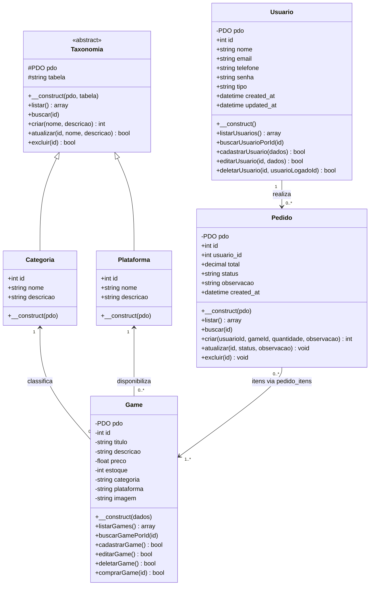
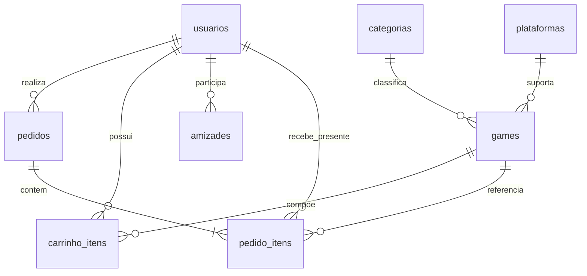
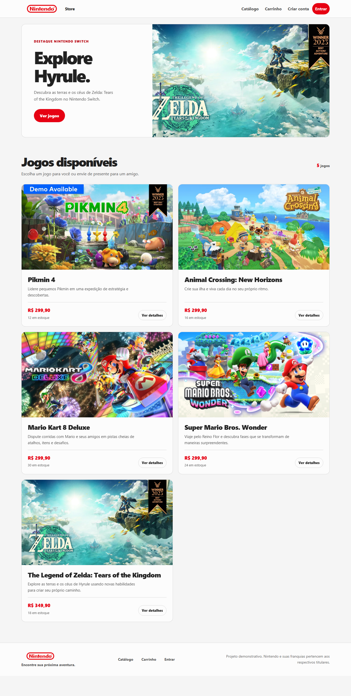
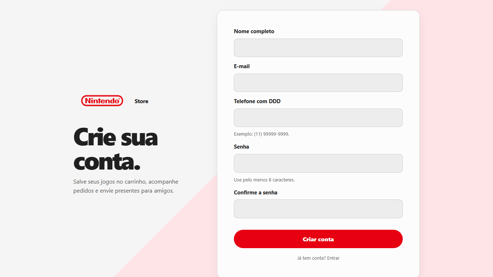
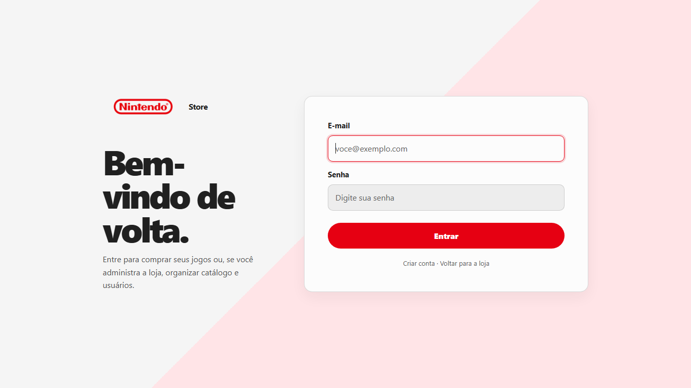
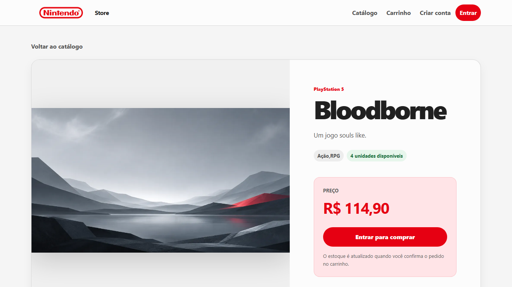
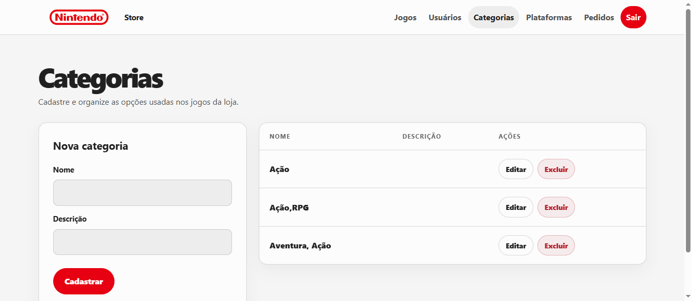

# Nintendo Store

**Integrante:** Pedro Henrique Santos Barbosa

**Tema:** loja de jogos

**Repositório público:** [TalesCouti/loja_gamesNintendo](https://github.com/TalesCouti/loja_gamesNintendo)

## Descrição

Sistema web de loja de jogos com catálogo público, conta de cliente, carrinho, pedidos e presentes entre amigos. Administradores gerenciam usuários, jogos, categorias, plataformas e pedidos. O projeto foi desenvolvido em PHP 8, MySQL, PDO, POO, MVC, HTML, CSS e JavaScript.

O fechamento do pedido é **demonstrativo**: registra os itens e atualiza o estoque, sem processar pagamento ou entregar uma licença digital.

## Funcionalidades e regras de negócio

- Clientes se cadastram com nome, e-mail único, telefone com DDD e senha. A senha é armazenada com `password_hash()`; o login usa `password_verify()`.
- Somente administradores acessam os CRUDs. Sessões e formulários usam cookie HTTP only e token CSRF.
- Jogos têm preço, estoque, categoria, plataforma e imagem opcional. Categorias e plataformas são cadastros relacionados aos jogos.
- O carrinho guarda itens por cliente. A confirmação cria um pedido e baixa o estoque em uma transação; se faltar estoque, a operação é desfeita.
- Amizades começam pendentes e precisam ser aceitas. Presentes só podem ser enviados para amigos confirmados.
- Cancelar ou excluir um pedido confirmado devolve os itens existentes ao estoque. Reativar um pedido exige estoque suficiente.
- A imagem enviada é validada por tipo; jogos sem arquivo disponível exibem uma arte neutra.

Extras implementados: upload de imagens, carrinho, controle de estoque, detalhe do jogo, amizades, presentes e validação de senha com JavaScript.

## Cinco classes com CRUD

| Classe | Criar | Consultar | Atualizar | Excluir |
| --- | --- | --- | --- | --- |
| `Usuario` | Cadastro público e admin | Lista e detalhe admin | Edição admin | Exclusão admin |
| `Game` | Cadastro admin | Catálogo, detalhe e lista admin | Edição admin | Exclusão admin |
| `Categoria` | Cadastro admin | Lista admin | Edição admin | Exclusão admin |
| `Plataforma` | Cadastro admin | Lista admin | Edição admin | Exclusão admin |
| `Pedido` | Carrinho e cadastro admin | Histórico e lista admin | Status e observação admin | Exclusão admin |

As rotas públicas ficam na raiz. O processamento está em `admin/controllers/`, as regras de dados em `admin/models/` e o HTML em `admin/views/`. Os arquivos das rotas incluem o controller correspondente para preservar os endereços existentes.

## Diagrama de classes UML

Os atributos públicos representam os campos persistidos no MySQL; `senha` guarda um hash. Em `Usuario`, `Pedido`, `Categoria` e `Plataforma`, os registros são lidos como arrays pelo PDO; esses campos não são propriedades declaradas nessas classes PHP. `Game` também mantém seus dados em propriedades privadas. `Categoria` e `Plataforma` herdam os métodos de CRUD de `Taxonomia`.

## Modelo do banco de dados

O [script SQL completo](banco%20de%20dados/schema.sql) cria o banco, tabelas, chaves primárias, chaves estrangeiras e dados iniciais. `usuarios.email`, `categorias.nome` e `plataformas.nome` são únicos. `pedido_itens` guarda título e preço do momento da compra.

## Instalação e execução

1. Instale PHP 8 com extensões `pdo_mysql`, `mbstring` e `fileinfo`, MySQL e Apache. O XAMPP já fornece esse ambiente.
2. Coloque o projeto em `htdocs/loja_games Nitendo` e inicie Apache e MySQL.
3. Em uma **base vazia**, importe [schema.sql](banco%20de%20dados/schema.sql) pelo phpMyAdmin ou com `mysql -u root -p < "banco de dados/schema.sql"`. O script cria `loja_games` e dados de teste.
4. Configure o banco por variáveis `DB_HOST`, `DB_NAME`, `DB_USER` e `DB_PASS`. Localmente também é possível criar `admin/config/local.php` com `<?php return ['password' => 'sua-senha'];`. Esse arquivo é ignorado pelo Git.
5. Acesse `http://localhost/loja_games%20Nitendo/`.

Para atualizar uma base já criada por versão anterior, faça backup e execute `php scripts/migrar_banco.php`. O script adiciona as estruturas ausentes e preserva os registros existentes.

Se essa base ainda mostrar os jogos de exemplo antigos, execute `php scripts/popular_catalogo_nintendo.php`. O script cadastra os cinco títulos Nintendo com as capas locais e remove apenas os quatro exemplos antigos que não estejam vinculados a carrinhos ou pedidos.

A arte de *Super Mario Bros. Wonder* foi obtida no [site oficial do jogo](https://supermariobroswonder.nintendo.com/). As imagens são usadas apenas nesta demonstração acadêmica.

### Contas de teste da importação nova

| Perfil | E-mail | Senha |
| --- | --- | --- |
| Administrador | `admin@loja.test` | `Admin123!` |
| Cliente | `cliente@loja.test` | `Cliente123!` |

Troque as senhas em uma instalação compartilhada. As contas acima são criadas apenas por `schema.sql`; uma base antiga mantém suas próprias contas.

## Telas principais

## Apresentação

Sugestão de demonstração: abrir o catálogo, criar uma conta, entrar, adicionar um jogo ao carrinho, confirmar o pedido e mostrar a baixa de estoque. No painel, demonstrar os cinco CRUDs e o cancelamento com devolução ao estoque.
